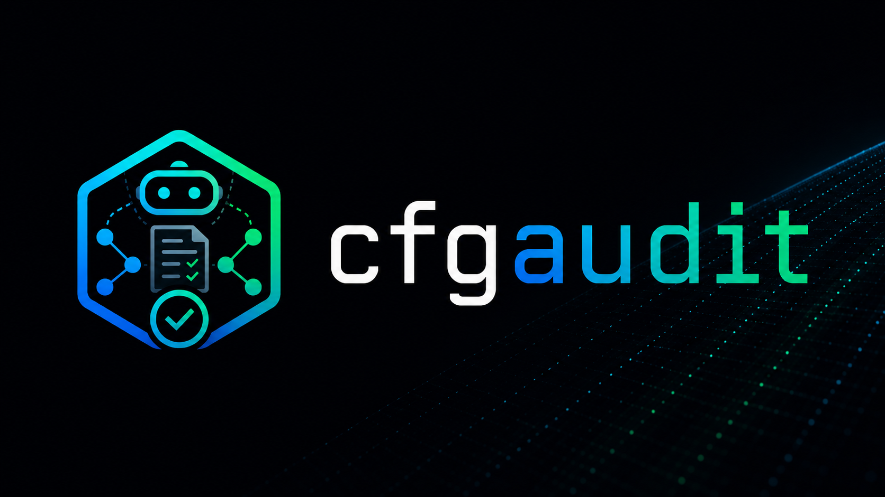

<p align="center">
  
</p>

<p align="center">
  <a href="https://app.codecov.io/gh/cfgaudit/cfgaudit"></a>
  <a href="https://scorecard.dev/viewer/?uri=github.com/cfgaudit/cfgaudit"></a>
  <a href="https://www.bestpractices.dev/projects/15618"></a>
  <a href="#verifying-a-release"></a>
  <a href="https://github.com/marketplace/actions/cfgaudit"></a>
  <a href="https://gitlab.com/explore/catalog/cfgaudit/cfgaudit"></a>
  <a href="#badge"></a>
</p>

# cfgaudit

Security auditor for AI-agent configuration files.

cfgaudit scans the configuration of AI coding assistants — starting with [Claude Code](https://docs.anthropic.com/en/docs/claude-code) — and flags settings that violate the principle of least privilege or leave sensitive files exposed to the agent's context.

Every finding maps to an [OWASP GenAI LLM Top 10 2026](https://genai.owasp.org/resource/owasp-genai-llm-top-10-2026/) risk (the primary mapping). Two secondary lenses are also provided: the [OWASP MCP Top 10](docs/rules/README.md#owasp-mcp-top-10-mapping-secondary) for the MCP-server rules, and the [OWASP AISVS 1.01 mapping](docs/aisvs-mapping.md) for teams who verify against the AI Security Verification Standard. A behavioral [crosswalk to AVE](docs/cfgaudit-to-ave.md) (Agentic Vulnerability Enumeration) maps the rules to AVE's behavioral classes. The primary OWASP LLM id **and** the mapped AVE id ride in the JSON and SARIF output (`OWASP`/`AVEID` in JSON; `properties.owasp_llm`/`properties.ave_id` in SARIF, alongside the CFG `ruleId`). The rule→AVE mapping lives in a single file (`cmd/cfgaudit/avemap.go`) with the crosswalk doc as its human-readable companion.

---

## Install

Homebrew (macOS / Linux):

```sh
brew install cfgaudit/tap/cfgaudit
```

With Python tooling (the wheel carries the prebuilt binary, no Python code):

```sh
pipx install cfgaudit      # or: uv tool install cfgaudit
uvx cfgaudit .             # run once without installing
```

Pin it next to your other linters with `cfgaudit==X.Y.Z` in a requirements file.

With Node.js (the package runs the prebuilt binary for your platform, no install script):

```sh
npx cfgaudit@1.19.0 .                                   # run once without installing
npm install --save-dev --save-exact cfgaudit@1.19.0     # pin it in a JavaScript project
```

Keep the version pinned: cfgaudit reports an unpinned `npx` package in an MCP server ([CFG010](docs/rules/CFG010.md)) for the same reason.

With the Go toolchain:

```sh
go install github.com/cfgaudit/cfgaudit/cmd/cfgaudit@latest
```

Or download a pre-built binary (Linux / macOS / Windows, amd64 / arm64) from the [releases page](https://github.com/cfgaudit/cfgaudit/releases).

Container image:

```sh
docker run --rm -v "$PWD:/work" -w /work ghcr.io/cfgaudit/cfgaudit:latest .
```

The image includes [ShellCheck](https://www.shellcheck.net/), so `--shellcheck` ([CFG045](docs/rules/CFG045.md)) works there and in the GitHub Action and GitLab components, which run the same image.

The image runs unprivileged as uid `65532`, so the files you mount must be readable by that uid (normal `644`/`755` permissions are fine). cfgaudit only reads them — write the report with a shell redirection on the host (`> report.sarif`) rather than into the mount.

---

## Usage

```sh
cfgaudit .                                   # audit the current directory
cfgaudit --format sarif . > cfgaudit.sarif   # for GitHub Code Scanning
cfgaudit explain CFG001                      # a rule's documentation in the terminal
cfgaudit list --agent cursor                 # the rules for one agent
cfgaudit init                                # a hardened .claude/settings.json for a new project
```

cfgaudit exits 1 when it reports an `error` finding, 0 when it reports only `warn` or `info` findings or none, and 2 on a usage or tool error. [Usage](docs/usage.md) has every flag, the output formats, the `init` and `policy` subcommands, the exit codes and the configuration file.

<a id="configuration-file-cfgaudityml"></a>**Configuration file.** A `.cfgaudit.yml` in the scanned directory turns rules off or changes their severity, excludes paths and sets an organisation policy: see [Configuration file](docs/usage.md#configuration-file-cfgaudityml). When you scan a repository you do not trust, do not let its own file configure the audit ([Scanning a repository you do not trust](docs/usage.md#untrusted-repositories)).

---

## GitHub Action

```yaml
- uses: cfgaudit/cfgaudit@v1
  with:
    path: .
```

SARIF upload to GitHub Code Scanning and every input and output are in [CI integration](docs/ci-integration.md#github-action).

## GitLab CI/CD component

```yaml
include:
  - component: gitlab.com/cfgaudit/cfgaudit/cfgaudit@v1.19.0
    inputs:
      path: .
```

The Code Quality template and every input are in [CI integration](docs/ci-integration.md#gitlab-cicd-component).

## pre-commit hook

For the [pre-commit framework](https://pre-commit.com/), see [CI integration](docs/ci-integration.md#pre-commit-hook).

## Claude Code plugin

```text
/plugin marketplace add cfgaudit/cfgaudit
/plugin install cfgaudit@cfgaudit
```

The plugin adds `/cfgaudit:scan`, `/cfgaudit:explain` and `/cfgaudit:init`, and hooks that scan after edits to agent configuration and when a session ends. Team rollout and the details are in [CI integration](docs/ci-integration.md#claude-code-plugin).

---

## What cfgaudit checks

The rules are grouped by the configuration they read. [Rules](docs/rules/README.md) lists every rule with its severity and OWASP risk, and `cfgaudit list` prints them:

- [`settings.json` — permissions, env, hooks & files](docs/rules/README.md#settingsjson--permissions-env-hooks--files)
- [MCP servers — `settings.json` `mcpServers` & `.mcp.json`](docs/rules/README.md#mcp-servers--settingsjson-mcpservers--mcpjson)
- [Instruction files — `CLAUDE.md` & other agents](docs/rules/README.md#instruction-files--claudemd--other-agents)
- [Plugin & skill packages](docs/rules/README.md#plugin--skill-packages)
- [Agent-skills lockfile — `skills-lock.json`](docs/rules/README.md#agent-skills-lockfile--skills-lockjson)
- [VS Code workspace — `.vscode/`](docs/rules/README.md#vs-code-workspace--vscode)
- [Cursor & GitHub Copilot — hooks, permissions and repository settings](docs/rules/README.md#cursor--github-copilot--hooks-permissions-and-repository-settings)
- [Gemini CLI — `.gemini/settings.json` & `GEMINI.md`](docs/rules/README.md#gemini-cli--geminisettingsjson--geminimd)
- [OpenAI Codex CLI — `.codex/config.toml` & `AGENTS.md`](docs/rules/README.md#openai-codex-cli--codexconfigtoml--agentsmd)
- [Continue — `.continue/config.yaml` & `.continue/settings.json`](docs/rules/README.md#continue--continueconfigyaml--continuesettingsjson)
- [Devin CLI — `.devin/` and everything it imports](docs/rules/README.md#devin-cli--devin-and-everything-it-imports)
- [Devin Desktop (formerly Windsurf) — `.devin/`, with `.windsurf/` as the fallback](docs/rules/README.md#devin-desktop-formerly-windsurf--devin-with-windsurf-as-the-fallback)
- [OpenCode — `opencode.json` and its siblings](docs/rules/README.md#opencode--opencodejson-and-its-siblings)
- [xAI Grok CLI — `.grok/`](docs/rules/README.md#xai-grok-cli--grok)
- [qwen-code — `.qwen/` & `QWEN.md`](docs/rules/README.md#qwen-code--qwen--qwenmd)
- [Kimi Code — `.kimi-code/` & `.agents/agents/`](docs/rules/README.md#kimi-code--kimi-code--agentsagents)

How the rules map to the OWASP risks, and which risks a configuration file cannot show, is in [OWASP mapping](docs/rules/README.md#owasp-mapping).

---

## Verifying a release

Releases from v1.17.0 on carry SLSA Build Level 3 provenance, and the container image is signed with cosign. The commands to check a download before you run it are in [Verifying a release](docs/verifying-releases.md).

---

## Badge

Using cfgaudit on your project? Show it in your README:

[](https://github.com/cfgaudit/cfgaudit)

```markdown
[](https://github.com/cfgaudit/cfgaudit)
```

To show it on a GitLab project page, add it under **Settings → General → Badges** with:

- **Link**: `https://github.com/cfgaudit/cfgaudit`
- **Badge image URL**: `https://img.shields.io/endpoint?url=https://raw.githubusercontent.com/cfgaudit/cfgaudit/main/assets/badge/v1.json`

---

## Contributing

See [CONTRIBUTING.md](CONTRIBUTING.md) for dev setup, the test loop, and the step-by-step recipe for adding a new rule. How cfgaudit is tested is in [TESTING.md](TESTING.md). Participation is governed by the [Code of Conduct](CODE_OF_CONDUCT.md); what is planned next is in the [roadmap](ROADMAP.md).

If cfgaudit is useful to you, a star on GitHub helps other people find it.

---

## License

Apache 2.0, see [LICENSE](LICENSE). The repository follows the [REUSE specification](https://reuse.software/): every file carries or is assigned its copyright and license, and `reuse lint` passes.
